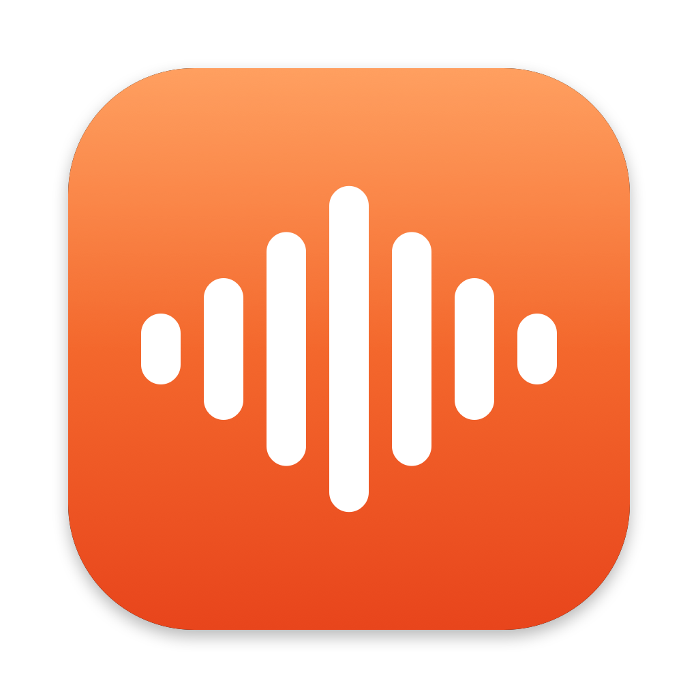

<p align="center"></p>

# Murmur

Hold a key, talk, let go. Your words are typed wherever your cursor is.

Murmur is a dictation app for the Mac that runs entirely on your machine, using only what Apple ships with macOS. No account, no subscription, nothing else to install, no audio sent anywhere.

## What it does

| Do this | Get this |
|---|---|
| Hold fn, talk, let go | Your words show live while you talk, then appear where you're typing |
| Double-tap fn | Hands-free. Tap fn again to stop. A single tap does nothing |
| Esc while talking | Cancel |
| ⌥⌘V | Type the last dictation again |
| Say "first… second… third…", "number one…" or "bullet point…" | A numbered or bulleted list |
| Say "new line" or "new paragraph" | A line break |
| Say a voice shortcut, like "add my office email" | Its text, set up in Settings |
| Click the menu bar icon | Your recent dictations. Click one to copy it |

**Tidy-up.** With Apple Intelligence on, Murmur removes "um"s, repeats and self-corrections ("Tuesday, no actually Wednesday" becomes "Wednesday") and fixes punctuation. If the model rewrites, reorders or answers your words instead of tidying them, Murmur types exactly what you said.

**Nothing gets lost.** Every dictation is saved before it is typed. If Murmur can't find a text field, the words stay on your clipboard. If speech recognition fails, you can retry the recording from the menu.

## Requirements

- A Mac with Apple silicon, on macOS 26 or later
- Xcode 26 or later, to build it
- Optional: Apple Intelligence turned on, for tidy-up

No other software or models. The first launch asks macOS to fetch Apple's on-device speech model for your accent.

## Install

**Download:** grab `Murmur-x.y.z.dmg` from the [latest release](https://github.com/karim-dev06/murmur/releases/latest), open it, and drag Murmur into Applications. It is signed and notarized by Apple, so it opens without warnings.

**Or build it from source:**

```bash
git clone https://github.com/karim-dev06/murmur.git
cd murmur
./scripts/build.sh --install
```

This builds the app, copies it to `/Applications` and opens it. Look for the waveform in the menu bar.

**Signing.** Without a certificate the app is signed ad hoc, and macOS asks for permissions again after every rebuild. To avoid that, put your Apple Development certificate's name or SHA-1 in a `.signing-identity` file in the project folder. `security find-identity -v -p codesigning` lists yours.

## One-time setup

The settings window opens on first launch and shows what is missing.

1. **Accessibility:** System Settings → Privacy & Security → Accessibility → turn on Murmur. This lets it see the talk key and type for you.
2. **Microphone:** allow it when asked.
3. **Globe key:** System Settings → Keyboard → "Press 🌐 key to" → Do Nothing. Otherwise the emoji picker opens every time you let go of fn.

No fn key on your keyboard? Pick "Hold right Option" in settings.

## How it works

| Step | What does it |
|---|---|
| Hearing you | Apple's on-device speech recognition (`SpeechAnalyzer`), live while you talk |
| Tidy-up | Apple Intelligence's on-device model (`FoundationModels`) |
| Typing | A paste into the focused app, then your clipboard is put back |

Pick the English closest to how you speak (US, UK, India and more) under Settings → Speech.

## Privacy

- Audio is processed on your Mac and not kept.
- Dictation history is stored in `~/Library/Application Support/Murmur/history.json`. Clear it from the menu bar icon → Clear history.
- Murmur sends nothing over the internet. The one exception is macOS itself, which may download Apple's speech model the first time.

## Testing without a microphone

```bash
build.noindex/Murmur.app/Contents/MacOS/Murmur --clean "um so can we meet tuesday no actually wednesday"
```

```bash
build.noindex/Murmur.app/Contents/MacOS/Murmur --transcribe some-audio.wav
```

`--live some-audio.wav` streams a file as if spoken. `--render-settings out.png` draws the settings window to an image.

## The icon

`scripts/make-icon.swift` draws it. Run `swift scripts/make-icon.swift --preview out.png` to compare the themes, and `swift scripts/make-icon.swift tangerine` to rebuild `Resources/AppIcon.icns`.

## Releasing

`scripts/release.sh` builds, signs with a Developer ID certificate, has Apple notarize the app and the disk image, and with `--publish` posts it as a GitHub release. It needs a Developer ID Application certificate and notarization credentials saved with `xcrun notarytool store-credentials`.

## License

MIT. See [LICENSE](LICENSE).
