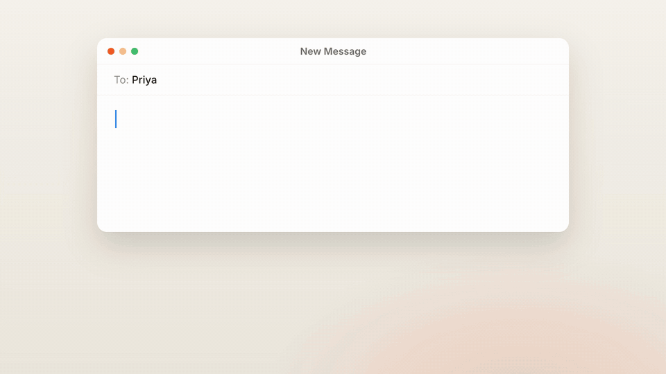
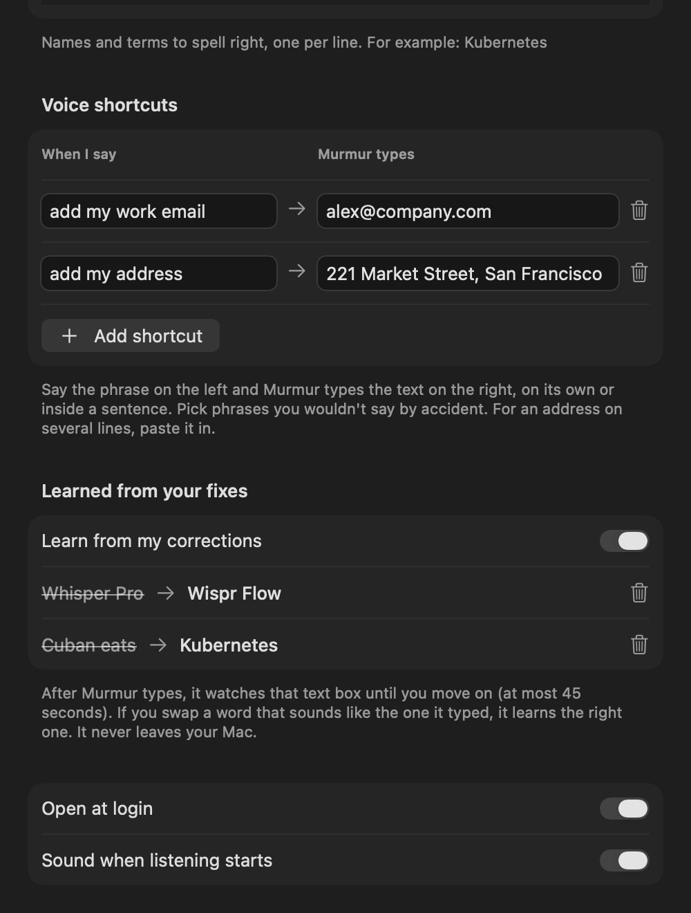

<p align="center">
  
</p>

<h1 align="center">Murmur</h1>

<p align="center">
  <b>Hold a key. Talk. Your words appear wherever you're typing, already tidied.</b><br>
  Free, private dictation for your Mac. A local alternative to Wispr Flow that never sends your voice anywhere.
</p>

<p align="center">
  <a href="https://github.com/karim-dev06/murmur/releases/latest/download/Murmur.dmg">
    
  </a>
</p>

<p align="center">
  <sub>macOS 26 or later · Apple silicon · under 1 MB · signed and notarized by Apple</sub>
</p>

<p align="center">
  
</p>

---

## Why Murmur

|                         | **Murmur**                  | Cloud dictation apps     |
| ----------------------- | --------------------------- | ------------------------ |
| Price                   | **Free**                    | Usually a subscription   |
| Your voice              | **Stays on your Mac**       | Sent to their servers    |
| Works offline           | **Yes**                     | No                       |
| Account                 | **None**                    | Usually required         |

## What it does

**Words appear as you speak.** A small bar at the bottom of the screen shows what Murmur hears, live. Let go and the text lands in the app you're using about a second later.

**Tidy text, not a transcript.** Ums, repeats and false starts are removed. Change your mind mid-sentence ("Tuesday, no actually Wednesday") and only the final version is typed. Punctuation and capitals are fixed for you.

**Lists on their own.** Say "first… second… third…" or "bullet point…" and you get a real numbered or bulleted list. Say "new line" or "new paragraph" for line breaks.

**Talks like a developer.** Over 130 built-in fixes for tech words speech recognition gets wrong, learned from recordings in Indian, American and British English: "post hog" becomes *PostHog*, "full request" becomes *pull request*, "back end to vessel" becomes *backend to Vercel*. Risky ones only apply when you're clearly talking about code, so "I play the guitar" stays as it is.

**Learns your words.** Fix a misheard name right after Murmur types it, say "Whisper Pro" to *Wispr Flow*, and Murmur gets it right from then on. It learns only sound-alike swaps, never your rewrites, and you can see and delete everything it learned in settings.

**Voice shortcuts.** Say "add my work email" and your email is typed. Set up as many as you like.

**Never loses a word.** Every dictation is saved before it's typed. Your last ones are one click away in the menu bar, and ⌥⌘V types the last one again.

**Works everywhere you type.** Mail, Slack, Notes, your browser, your code editor. If it's a text box, Murmur can type into it.

<p align="center">
  
</p>

## Install

1. **[Download Murmur](https://github.com/karim-dev06/murmur/releases/latest/download/Murmur.dmg)** and open it.
2. Drag **Murmur** into **Applications**, then open it.
3. The settings window shows three quick setup steps. Click **Fix** on each:
   - **Accessibility**, so Murmur can see the talk key and type for you
   - **Microphone**
   - **Keyboard → "Press 🌐 key to" → Do Nothing**, so the emoji picker stays away

That's it. Look for the waveform in your menu bar.

## Use it

| Do this | Get this |
| --- | --- |
| Hold **fn**, talk, let go | Your words, typed and tidied |
| Double-tap **fn** | Hands-free. Tap **fn** again to stop |
| **Esc** while talking | Cancel |
| **⌥⌘V** | Type the last dictation again |
| Click the menu bar icon | Recent dictations. Click one to copy it |

No fn key on your keyboard? Pick "Hold right Option" in settings.

## Private by design

- Speech recognition and tidy-up run on your Mac, using Apple's own on-device models.
- No account, no tracking, nothing sent over the internet. The one exception is macOS itself, which may download Apple's speech model the first time.
- Audio is never kept. Your dictation history stays on your Mac, and you can clear it from the menu.
- To learn from your fixes, Murmur re-reads only the text box it just typed into, until you move on (45 seconds at most). You can turn this off in settings.

## Questions

**Which languages?** English, in the accent you choose in settings: US, UK, India, Australia, Canada, Ireland, New Zealand, Singapore or South Africa.

**Do I need Apple Intelligence?** Only for tidy-up. Without it, Murmur types exactly what you said.

**Intel Macs or older macOS?** No. Murmur needs Apple silicon and macOS 26, because that's where Apple's on-device speech and language models live.

**Why does it need Accessibility?** To notice the fn key from any app and to type the text for you. The only other thing it looks at is which text box has focus, so it knows where to type.

---

## For developers

Murmur is a small Swift app with no dependencies beyond macOS. Contributions welcome.

```bash
git clone https://github.com/karim-dev06/murmur.git
cd murmur
./scripts/build.sh --install
```

This needs Xcode 26 or later. It builds the app, copies it to `/Applications` and opens it. Without a certificate the app is signed ad hoc, and macOS asks for permissions again after each rebuild. To avoid that, put your Apple Development certificate's name in a `.signing-identity` file.

**Test without a microphone:**

```bash
build.noindex/Murmur.app/Contents/MacOS/Murmur --clean "um so can we meet tuesday no actually wednesday"
```

`--transcribe file.wav` runs a recording through speech and tidy-up. `--live file.wav` streams it as if spoken.

**Release:** `scripts/release.sh --publish` builds, signs with a Developer ID certificate, has Apple notarize it, and posts it here.

**Demo video:** made with [HyperFrames](https://hyperframes.heygen.com) in `demo/`. The icon is drawn by `scripts/make-icon.swift`.

## License

MIT. See [LICENSE](LICENSE).
